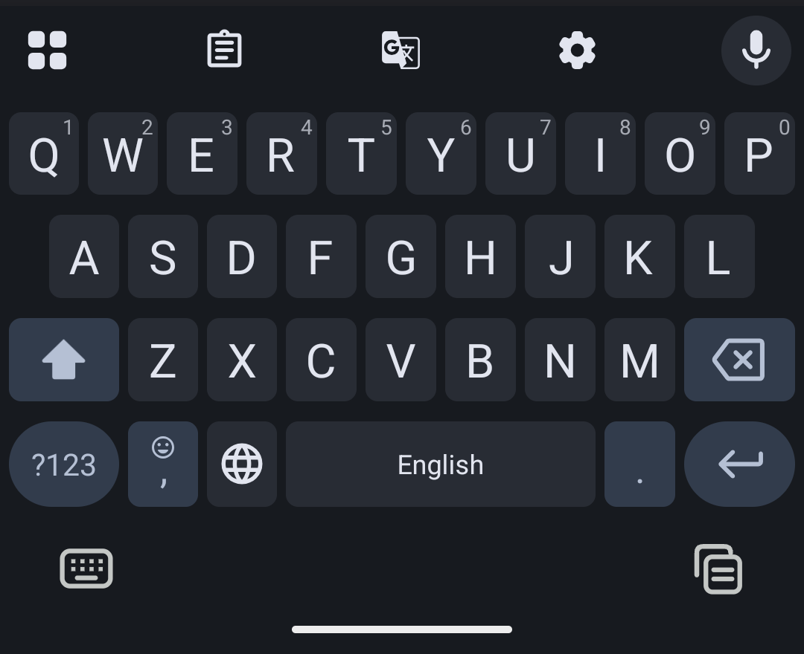

# Keyboard bar

An LSPosed module that adds a bar under the keys of any keyboard: shortcuts, cursor slide,
clipboard history and frequent phrases.



## Install

1. Install the APK from [Releases](../../releases).
2. Enable **Keyboard bar** in LSPosed and add your keyboard (Gboard, SwiftKey, ...) to its scope.
3. Force stop the keyboard, or reboot.

Long-press the left or right button to choose its shortcut.

Android 11 or newer, with a keyboard that draws its own navigation bar (gesture navigation).

## Build

```sh
./gradlew assembleRelease
```
